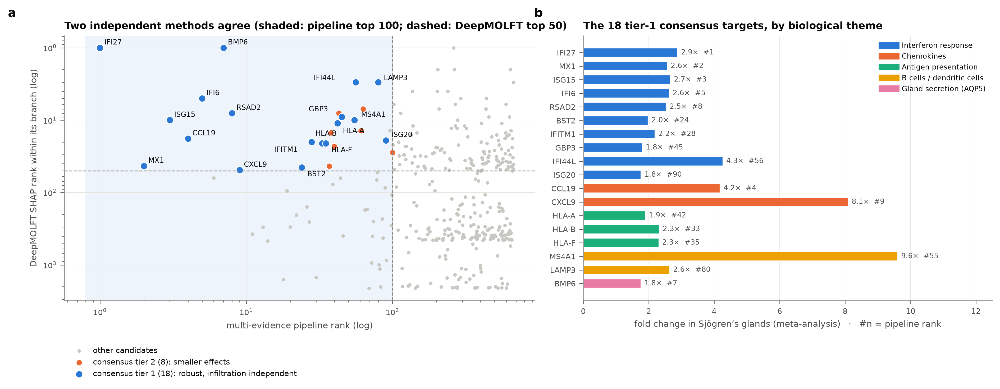
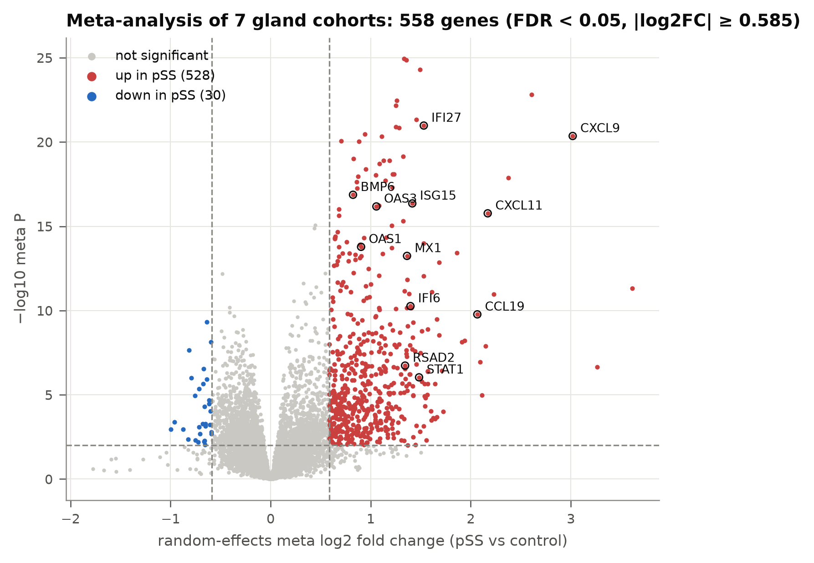
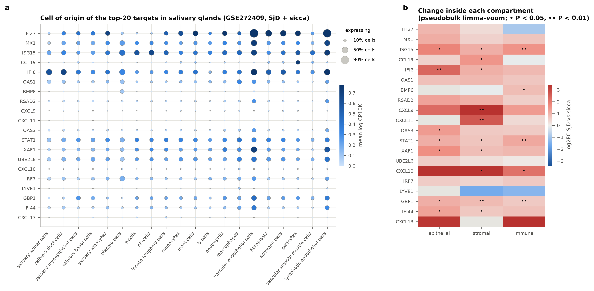
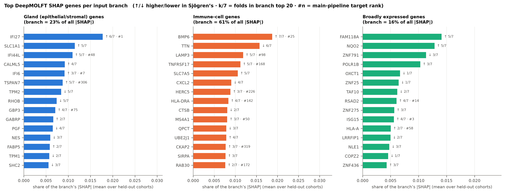
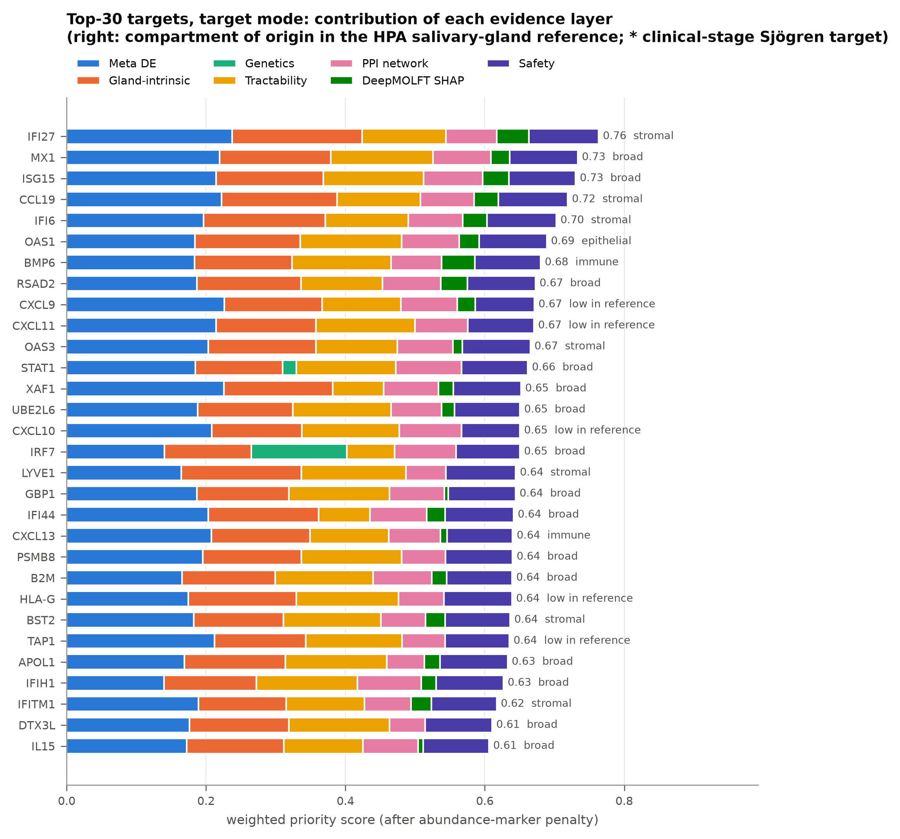

# Sjögren’s disease RNA target discovery

A reproducible pipeline that finds and prioritises drug-target candidates for primary Sjögren’s disease from
salivary-gland transcriptomes. It combines a random-effects meta-analysis of **seven public gland cohorts (252
samples)**, a deconvolution step that separates gland changes from immune-cell infiltration, a **DeepMOLFT**
late-fusion deep network with SHAP explanations, a seven-layer evidence ranking, and validation in independent
salivary-gland single-cell data.

**Main result:** the gland’s own epithelial cells switch on an interferon programme, and **18 consensus targets** are
supported by both the statistical pipeline and the deep-learning model, led by **IFI27, MX1, ISG15, CCL19, IFI6, BMP6
and CXCL9**.



---

## Contents

| Path | What it is |
|---|---|
| `sjogren_pipeline/` | Pipeline stages 1–9 (one module per stage) |
| `R/` | R helpers: RMA from CEL files, batched limma / voom jobs |
| `deepmolft_task/` | DeepMOLFT late-fusion network + SHAP, leave-one-cohort-out ([details](deepmolft_task/README.md)) |
| `config.yaml` | Every setting: cohorts, label rules, thresholds, ranking weights |
| `data/external/` | Small curated inputs (GWAS gene list, marker panel); large resources are downloaded on first use |
| `results/` | Curated result tables (meta-analysis, models, DeepMOLFT, targets, validation) |
| `figures/` | 19 figures (PNG); legends in [`docs/FIGURES.md`](docs/FIGURES.md) |
| `docs/DATASETS.md` | Cohort, platform and resource details ([link](docs/DATASETS.md)) |
| `tests/` | Synthetic tests for the single-cell, deconvolution and meta-analysis code |
| `tools/collect_results.py` | Refreshes `results/` and `figures/` from a new run |

## Data

| GEO | Tissue | Data | Cases vs controls | Role |
|---|---|---|---|---|
| GSE40611 | Parotid | Affymetrix CEL → RMA | 17 vs 18 healthy | Discovery, classical ML |
| GSE154926 | Minor gland | RNA-seq counts | 43 vs 7 healthy | Meta-analysis |
| GSE173808 | Parotid + labial (paired) | RNA-seq counts | 75 vs 39 sicca samples | Meta-analysis, histology check |
| GSE157159 | Minor gland | RNA-seq TPM | 9 vs 8 | Meta-analysis |
| GSE23117 | Minor gland | Affymetrix (MAS5) | 10 vs 4 | Meta-analysis |
| GSE40568 | Labial gland | Affymetrix CEL → RMA | 5 vs 3 | Meta-analysis |
| GSE127952 | Minor gland, low focus score | Agilent log ratios | 8 vs 6 | Meta-analysis |
| GSE272409 | Minor gland, scRNA-seq | 10x | 7 SjD vs 6 sicca | Validation only |

Full details, exclusions and external resources (Human Protein Atlas, Open Targets, STRING): [`docs/DATASETS.md`](docs/DATASETS.md).

## Pipeline

| # | Stage | Method |
|---|---|---|
| 1 | Download | GEO metadata (GEOparse), raw CEL files → RMA in R, RNA-seq count / TPM matrices, rule-based labels |
| 2 | Preprocess | Platform-specific normalisation and filtering, probe → gene, array QC (RLE), label-free batch choice for ML |
| 3 | Differential expression | limma per cohort (voomWithQualityWeights for counts, limma-trend/robust for arrays, duplicateCorrelation for paired glands); NNLS deconvolution against the HPA salivary-gland atlas; DerSimonian–Laird random-effects meta-analysis with leave-one-cohort-out and replication-only checks; label-permutation calibration |
| 4 | Pathways | GSEA prerank and ORA (GO, Reactome, KEGG, MSigDB Hallmark) |
| 5 | Classical models | Six classifiers with nested cross-validation; external test on the six other cohorts |
| 6 | Explain | SHAP / integrated gradients with deletion-curve faithfulness tests |
| — | **DeepMOLFT** | Late-fusion DNN with three gene branches (gland, immune, broad); leave-one-cohort-out; Optuna; 5-seed ensemble; SHAP on unseen cohorts |
| 7 | Rank | Seven evidence layers (meta DE 25%, gland-intrinsic 20%, genetics 15%, tractability 15%, STRING network 10%, safety 10%, DeepMOLFT SHAP 5%), infiltrate penalty, weight sensitivity, held-out clinical-target benchmark, consensus of both methods |
| 8 | Validate | Per-cohort replication, gland single-cell cell-of-origin and within-compartment change, qPCR panel design |
| 9 | Figures | Report figures and model metric tables |

## Key results

| | |
|---|---|
| Genes at meta-analysis FDR < 0.05 | 2,570 of 12,953 |
| Robust candidates (≥ 1.5-fold, significant whichever cohort is left out) | **527** (502 up, 25 down) |
| Replicate without the discovery cohort | 488 |
| Survive the immune-infiltration adjustment | 194 |
| False-positive calibration (shuffled labels, fraction p < 0.05) | 6.1% (5% expected) |
| Deconvolved immune fraction vs histological %CD45 | Spearman ρ = 0.73 (parotid), 0.75 (labial) |
| Top Hallmark pathways, before and after adjustment | Interferon-γ and interferon-α response |
| Classical models, nested CV in GSE40611 | AUROC 0.94–0.96 |
| Classical models, external cohorts | AUROC 0.51–0.94 |
| DeepMOLFT, leave-one-cohort-out (pooled AUROC) | 0.81 (random forest 0.84) |
| Consensus targets, tier 1 | **18** |

**Top-10 targets:** IFI27, MX1, ISG15, CCL19, IFI6, OAS1, BMP6, RSAD2, CXCL9, CXCL11. All change in the same
direction in every cohort and survive the infiltration adjustment
([`results/targets/target_ranking_all.csv`](results/targets/target_ranking_all.csv)).

**Tier-1 consensus** ([`results/targets/target_consensus.csv`](results/targets/target_consensus.csv)): interferon
response (IFI27, MX1, ISG15, IFI6, RSAD2, BST2, IFITM1, GBP3, IFI44L, ISG20), chemokines (CCL19, CXCL9), antigen
presentation (HLA-A, HLA-B, HLA-F), B / dendritic cells (MS4A1, LAMP3) and gland secretion (BMP6).

**Single-cell validation** (GSE272409, not used for ranking): ISG15, IFI6, STAT1 and XAF1 rise inside epithelial cells
of SjD glands compared with sicca controls (P < 0.05).

| | |
|---|---|
|  |  |
|  |  |

## Installation

```bash
pip install -r requirements.txt          # or: conda env create -f environment.yml
```

R ≥ 4.3 with Bioconductor packages:

```r
BiocManager::install(c("limma", "edgeR", "affy", "hgu133plus2cdf"))
install.packages("jsonlite")
```

On Windows, import `torch` before `shap` (the DeepMOLFT package does this); set `KMP_DUPLICATE_LIB_OK=TRUE` when
conda NumPy and pip PyTorch are mixed (`run_pipeline.py` sets it).

## Usage

```bash
python run_pipeline.py --stages 1 2 3 4 5 6     # data → genes → classical models (first run downloads ~1 GB)
python deepmolft_task/run_deepmolft.py          # DeepMOLFT + SHAP (~1 h on CPU)
python run_pipeline.py --stages 7 8 9           # ranking, validation, figures
python tools/collect_results.py                 # refresh results/ and figures/
python tests/test_pipeline_synthetic.py         # synthetic checks
```

Stage 7 falls back to the stage-6 explanations if DeepMOLFT has not been run (`config.yaml → ranking.model_importance`).
`ranking.mode: biomarker` re-ranks for biomarkers (infiltrate genes allowed, no druggability or safety terms).

## Design choices

* **Raw data where available.** GPL570 CEL files are RMA-normalised instead of using deposited values.
* **Calibration is tested, not assumed.** Under within-batch label permutation 6.1% of genes reach p < 0.05.
  limma `arrayWeights` was tried and rejected (32%).
* **Gland versus infiltrate.** Every gene is also tested after removing the deconvolved immune fraction; genes that
  only mark more lymphocytes are penalised in target mode.
* **No leakage.** Feature selection, scaling and tuning happen inside training folds; the ML batch correction is chosen
  without labels; DeepMOLFT tuning and early stopping never see the held-out cohort.
* **Honest benchmark.** Clinical-stage Sjögren’s drug targets (Open Targets) are excluded from scoring and used only to
  evaluate the ranking.

## Limitations

* All results are computational and need experimental confirmation (a qPCR panel design is provided).
* The deconvolution adjustment is partial; some lymphocyte genes still pass it.
* The HPA reference is healthy tissue, so interferon-induced genes (CXCL9/10/11) have no reliable cell of origin
  there; the single-cell data fill this gap.
* Target mode deliberately down-weights B- and T-cell genes, so it recovers clinical-stage Sjögren’s drug targets
  poorly (AUROC 0.55); use `results/targets/target_ranking_immune.csv` or biomarker mode for immune-cell targets.
* DeepMOLFT adds an independent explanation, not extra accuracy.

## Acknowledgements

Expression data from NCBI GEO (accessions above); cell-type reference from the Human Protein Atlas; target
annotations from the Open Targets Platform; protein interactions from STRING. The late-fusion architecture follows
[DeepMOLFT](https://github.com/priyashdhakal/DeepMOLFT).
